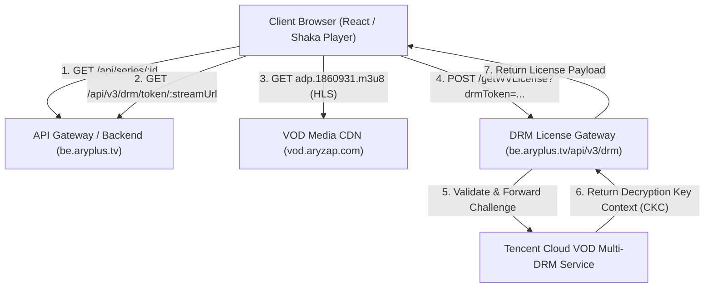
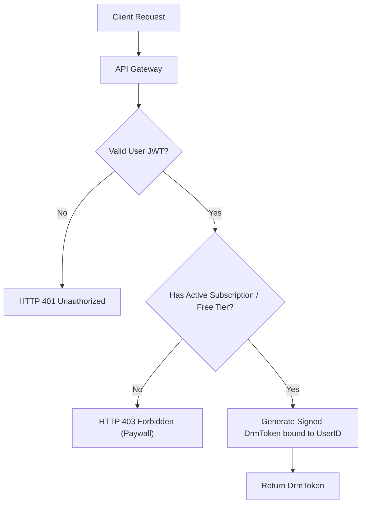

# System Architecture & Technical Flow Documentation

**Target System:** Video Streaming & DRM Subsystem (ARY Plus)  
**Document Purpose:** Educational Architecture Reference & Security Hardening Review  
**Date:** October 20, 2026  

---

## 1. Overview of the Architecture

The streaming platform is structured as a decoupled modern OTT (Over-The-Top) media architecture:



### Primary Components:
1. **Frontend Player:** React single-page app utilizing **Shaka Player** (or Radiant Media Player) interfacing with the browser's native **Encrypted Media Extensions (EME)**.
2. **Backend API (`be.aryplus.tv`):** Manages content catalog, series metadata, user accounts, and token signing.
3. **Media CDN (`vod.aryzap.com`):** Delivers HLS/DASH media playlists and encrypted video segments.
4. **License Server & Cloud DRM:** Built on **Tencent Cloud VOD Multi-DRM**, supporting both **Google Widevine Modular** (for Chrome/Edge/Firefox/Android) and **Apple FairPlay Streaming** (for Safari/iOS).

---

## 2. Step-by-Step Playback & DRM Lifecycle

### Step 1: Content Metadata Resolution
The client requests metadata for a specific series or video ID:
* **Endpoint:** `GET https://be.aryplus.tv/api/series/69bad0ba34f97c2d4ae5da34`
* **Headers:** `x-api-key: ak_37515186786306625012043079404171`
* **Response:**
  * Title, poster images, description, cast.
  * `seiresCDNWebLink`: Points to the HLS master playlist (`.../adp.1860931.m3u8`).
  * `drmEnabled`: Boolean flag indicating whether encryption is enforced.

---

### Step 2: DRM Token Generation
If `drmEnabled: true`, the player must obtain a signed DRM authorization token before requesting keys:
* **Endpoint:** `GET https://be.aryplus.tv/api/v3/drm/token/{streamUrl}`
* **Response Payload:**
  ```json
  {
    "message": "DrmToken generated successfully",
    "token": "eyJhbGciOiJIUzI1NiIsInR5cCI6IkpXVCJ9~eyJ0eXBlIjoiRHJtVG9rZW4iLCJhcHBJZCI6MTMxMzU2NTA4MCwiZmlsZUlkIjoiNTE0NTQwMzcxOTY5ODUzMzU5NSIsImN1cnJlbnRUaW1lU3RhbXAiOjE3OTI0MzcyODAsImV4cGlyZVRpbWVTdGFtcCI6MTc5MjQ1ODg4MCwicmFuZG9tIjo2MTMxNTAwNTA5LCJpc3N1ZXIiOiJjbGllbnQiLCJtdWx0aURybSI6MX0~ghsW_EBRItP4Yvdk9P6uz36cbuggvJhXUVy9eL0lghA"
  }
  ```
* **Token Structure:** A custom JWT consisting of three segments separated by `~`:
  * Segment 1: Header (`{"alg":"HS256","typ":"JWT"}`)
  * Segment 2: Claims (`{"appId":1313565080,"fileId":"5145403719698533595","expireTimeStamp":...,"multiDrm":1}`)
  * Segment 3: HMAC-SHA256 signature generated by the backend signing key.

---

### Step 3: Stream Playlist Inspection
When Shaka Player loads the playlist (`adp.1860931.m3u8`), each variant playlist contains the encryption metadata:
```m3u8
#EXT-X-KEY:METHOD=SAMPLE-AES,URI="data:text/plain;base64,AAAAknBzc2gAAAAA7e+LqXnWSs6jyCfc1R0h7QAAAHISEJywiODTepKCuZYQK4/7Nsk...",KEYID=0x9CB088E0D37A9282B996102B8FFB36C9,IV=0xED50F415037EDB2F610FD6B9B1DDFE55,KEYFORMATVERSIONS="1",KEYFORMAT="urn:uuid:edef8ba9-79d6-4ace-a3c8-27dcd51d21ed"
#EXT-X-KEY:METHOD=SAMPLE-AES,URI="skd://5145403719698533595",KEYFORMATVERSIONS="1",KEYFORMAT="com.apple.streamingkeydelivery"
```
* **Widevine:** Uses `KEYFORMAT="urn:uuid:edef8ba9-79d6-4ace-a3c8-27dcd51d21ed"` with the inlined PSSH (Protection System Specific Header) box.
* **FairPlay:** Uses `KEYFORMAT="com.apple.streamingkeydelivery"` with the asset URI `skd://<fileId>`.

---

### Step 4: License Acquisition via EME
1. Shaka Player extracts the PSSH box and triggers an `encrypted` event via the browser's **Encrypted Media Extensions (EME)**.
2. The browser's Content Decryption Module (CDM) creates an EME **License Challenge**.
3. Shaka dispatches a `POST` request with the challenge bytes to:
   * **Widevine URL:** `https://be.aryplus.tv/api/v3/drm/getWVLicense?drmToken={token}`
   * **FairPlay URL:** `https://be.aryplus.tv/api/v3/drm/getFPLicense?drmToken={token}`
4. The license server validates the `drmToken` signature and expiration, queries the Tencent Cloud KMS, and responds with a JSON object:
   ```json
   {
     "ckc": "<base64_encoded_license_payload>"
   }
   ```
5. Shaka Player's `registerResponseFilter` decodes the base64 string into a `Uint8Array` binary buffer and passes it back to the CDM.
6. The CDM decrypts the media streams in protected memory and delivers decoded frames to the HTML5 video element.

---

## 3. Architecture & Security Analysis

During the integration and analysis, three critical architectural patterns were observed:

### 1. Static API Key Stored in Client Frontend
* **Observed State:** The backend requires `x-api-key: ak_37515186786306625012043079404171` to accept requests.
* **Architectural Reality:** Any static key embedded in client-side code (JavaScript bundles, mobile APKs) is publicly discoverable. An API key proves which application codebase is making the call, but does **not** authenticate who the user is or whether they have access permissions.

### 2. Unauthenticated DRM Token Issuance
* **Observed State:** Calling `GET /api/v3/drm/token/:streamUrl` with the API key returns a signed, valid `DrmToken` without requiring a valid session (`Authorization: Bearer <token>`).
* **Architectural Flaw:** The token generation endpoint assumes that possession of the stream URL and API key implies authorization. Because no user ID or entitlement check is performed on the server side, any client can request valid playback keys for any catalog item.

### 3. Permissive Cross-Origin Resource Sharing (CORS)
* **Observed State:** `be.aryplus.tv` reflects whatever `Origin` header is supplied by the browser (e.g., `http://localhost:3000`, `https://aryplus-drm.vercel.app`), coupled with `access-control-allow-credentials: true`.
* **Architectural Flaw:** Permissive CORS allows third-party origins to query the backend API directly from arbitrary websites.

---

## 4. Recommended Security Hardening

To permanently resolve these structural weaknesses, the following improvements should be adopted:

### 1. Enforce Server-Side Entitlement Checks on Token Generation
Never issue a `DrmToken` based solely on the stream URL. The `/api/v3/drm/token` endpoint should require an authenticated session and verify entitlement:



### 2. Bind DRM Tokens to User Sessions
Include the authenticated user's ID (`userId`) and client IP hash in the `DrmToken` payload claims:
```json
{
  "type": "DrmToken",
  "appId": 1313565080,
  "fileId": "5145403719698533595",
  "userId": "usr_94821a7c",
  "currentTimeStamp": 1792437280,
  "expireTimeStamp": 1792438180,
  "multiDrm": 1
}
```
* Shorten token expiration from multiple hours down to **5–15 minutes** (sufficient for playback initialization).

### 3. Strict CORS Origin Whitelisting
Replace dynamic origin reflection with a strict whitelist of approved production domains:
```javascript
const allowedOrigins = [
  'https://aryplus.tv',
  'https://staging.aryplus.tv'
];

app.use(cors({
  origin: (origin, callback) => {
    if (!origin || allowedOrigins.includes(origin)) {
      callback(null, true);
    } else {
      callback(new Error('Cross-Origin Request Blocked'));
    }
  },
  credentials: true
}));
```

### 4. CDN Tokenization & Signed URLs
In addition to DRM encryption, secure the playlist delivery by requiring signed CloudFront/CDN cookies or query tokens (`?hdnea=...` or AWS CloudFront signed URLs). This ensures media chunks cannot be directly downloaded without valid CDN-level authorization.
